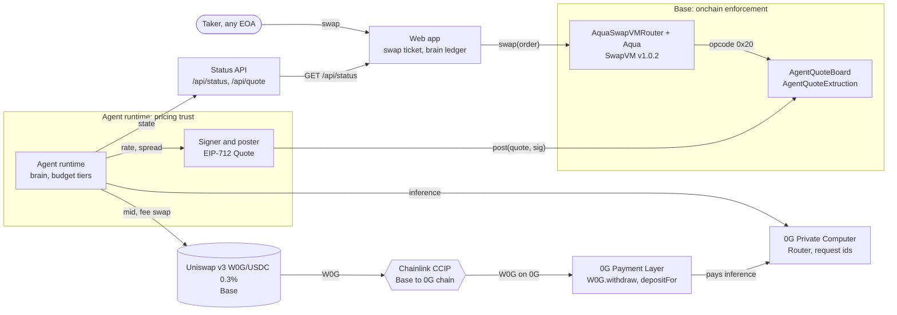

# Upkeep architecture

Interactive diagram with pan, zoom, search and relationship tracing: [docs/ARCHITECTURE.html](docs/ARCHITECTURE.html) (source: [docs/architecture.json](docs/architecture.json)).

## Components

### Agent runtime: `agent/src/runtime.ts`
One Bun process on a 15 second tick. Each tick reads the Base market and the agent's 0G Payment Layer balance, accrues fill fees from SwapVM `Swapped` events, runs the budget policy, asks the brain for a new price only when the policy calls a requote, signs and posts both directions, and runs the funding leg once accrued fees cross `FUNDING_THRESHOLD_USDC`. State persists to `STATE_PATH` after every step; once the CCIP message is sent, the pending transfer is saved, so a restart resumes the 0G side of the funding leg.

### Brain: `agent/src/brain.ts`
Calls the 0G Private Computer router (`/v1/chat/completions`, OpenAI compatible) with temperature 0, thinking off and a 256 token ceiling. The reply is parsed strictly: `rateE18` must be an integer within 3% of the Uniswap mid, `spreadBps` an integer from 5 to 500, `reason` non-empty, and the router must return a request id. Any miss raises a typed `BrainError` and nothing is signed. The router's billed cost (`x_0g_trace.billing.total_cost_usd_micro`) is captured per call.

### Budget: `agent/src/budget.ts`
A pure function from compute balance, today's spend and the daily cap to a tier.

| Tier | Trigger | Model | Behaviour |
| --- | --- | --- | --- |
| NORMAL | healthy balance | `0gm-1.0-35b-a3b` | requote when the mid moves 25 bps |
| LOW | balance under 0.5 0G or 75% of the cap spent | `qwen3.7-flash` | requote when the mid moves 100 bps |
| CRITICAL | balance under 0.1 0G or 90% of the cap spent | none | no inference, no requote |
| PAUSED | spend cap reached or balance under 0.05 0G | none | no inference, no posting |

Spend is measured from the onchain Payment Layer balance, so the cap counts what the router actually drew.

### Price reference: `agent/src/price.ts`
Reads `slot0().sqrtPriceX96` from the Uniswap v3 W0G/USDC 0.3% pool on Base (handles either token order) and sizes exact-in swaps with QuoterV2.

### Signer and poster: `agent/src/signer.ts`, `agent/src/poster.ts`
Signs the board's EIP-712 `Quote(maker, tokenIn, tokenOut, rateE18, expiry, nonce, inferenceId)` with `AGENT_PK` or an RPC-unlocked account, posts it, waits for the receipt and decodes board errors by name. `inferenceId` is `keccak256(requestId ‖ tokenIn ‖ tokenOut)`, so every onchain quote points back to one 0G request.

### Quote and state API
`agent/src/status.ts`: `GET /api/status` serves the persisted state (tier, balance, spend, inferences with request ids, quotes, fees, funding steps). `GET /api/quote` returns the live AquaSwapVMRouter `quote()` for an amount. CORS is pinned to the one `WEB_ORIGIN`.

### AgentQuoteBoard: `contracts/src/AgentQuoteBoard.sol`
EIP-712 domain `Upkeep AgentQuoteBoard`, version `1`. A maker registers its agent with `setAgent`; anyone may relay a quote the agent signed. Stores one quote per maker and direction.

### AgentQuoteExtruction: `contracts/src/AgentQuoteExtruction.sol`
An `IExtruction` called by the shipped Aqua program at opcode `0x20` on the deployed AquaSwapVMRouter v1.0.2, with the router bytecode untouched. It reads the board, prices exact-in and exact-out at the signed rate minus the strategy fee, and reverts `StaleQuote` when no current quote exists. The same check runs inside `quote()` and `swap()`, so the amount a taker is quoted is the amount the fill pays.

### AquaSwapVMRouter and Aqua (1inch)
Aqua holds the maker's W0G and USDC allowances for one two-sided strategy (`contracts/script/ShipStrategy.s.sol`). Any EOA fills through `AquaSwapVMRouter.swap`; `agent/src/taker.ts` builds the 22-byte exact-in taker traits.

### Funding leg: `agent/src/funding.ts`
Builds and sends, in order, each step waiting for its receipt:
1. approve and `exactInputSingle` on Uniswap SwapRouter02: accrued USDC fees to W0G on Base
2. approve and `ccipSend` on the Base CCIP router: W0G to 0G chain (selector `4426351306075016396`), fee quoted with `getFee`
3. poll the 0G chain W0G balance until CCIP delivery lands (`CCIP_TIMEOUT_MS`)
4. `W0G.withdraw` to native 0G
5. `PaymentLayer.depositFor(agent)` with the amount minus `ZG_GAS_RESERVE_WEI`

### Web app: `web/`
Next.js 16, wagmi 3, Tailwind 4. The swap page (`web/components/swap-ticket.tsx`) shows the signed price, its countdown to expiry and the 0G request behind it, then fills through AquaSwapVMRouter from the taker's wallet. The ledger page (`web/components/ledger-page.tsx`) shows the AI account balance, spend against the daily cap, the budget tier, fees accrued and the latest funding step.

## Trust boundaries

**The signer owns pricing trust.** The board stores the signed `rateE18` verbatim and deliberately reads no oracle: choosing the price is the agent's job, and the brain refuses any rate more than 3% from the Uniswap mid before the signer ever sees it. `BaseW0GTest.test_quoteFarOutsideMidBandStillFillsAtQuotedRate` pins this contract: the chain fills at exactly the signed rate. Takers see the signed rate and its 0G request id before they fill.

**The board enforces everything else, onchain, on every fill:**

| Property | Enforcement |
| --- | --- |
| Freshness | `post` rejects an expired quote; the extruction re-checks `block.timestamp > expiry` at fill time and reverts `StaleQuote` |
| Nonce | strictly increasing per maker (`NonceNotIncreasing`), so a replayed or older quote never lands |
| Pair | the stored quote's `tokenIn`/`tokenOut` must equal the swap's; same-token and zero-token pairs are rejected |
| Maker | quotes are keyed by maker and must match `query.maker`, so one maker's quote never prices another's strategy |
| Agent binding | the signature must recover to the maker's registered agent; every `setAgent` bumps an epoch that retires all outstanding quotes |
| Provenance | a zero `inferenceId` is rejected; every live quote carries its 0G request hash |

**Keys** stay in the process environment (`AGENT_PK`, `DEPLOYER_PK`, `MAKER_PK`) and are never written or logged. The fork flows sign with anvil's unlocked accounts and never read a real key.
