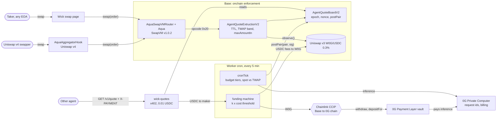

# Wick architecture

Interactive diagram with pan, zoom, search and relationship tracing: [docs/ARCHITECTURE.html](docs/ARCHITECTURE.html) (source: [docs/architecture.json](docs/architecture.json)). Unit costs and break-even math: [docs/ECONOMICS.md](docs/ECONOMICS.md).

## Components

### Worker cron: `web/worker/cron.ts`, `agent/src/worker-tick.ts`
One Cloudflare Worker serves the app, the read API and a cron trigger every 5 minutes. Each tick reads the Uniswap v3 spot and TWAP, the agent's 0G Payment Layer balance, its Base gas balance and the board, runs the budget policy, asks the brain for a price only when the policy calls a requote, signs both directions in one EIP-712 `Pair`, and posts it with one `postPair` transaction. The same tick advances the funding machine by at most one chain step. Reads, sends and receipts fall through three Base RPCs with batched JSON-RPC and multicall, so a tick stays inside the Workers 50 subrequest budget.

### Brain: `agent/src/brain.ts`
`askDecision` makes one call to the 0G Private Computer router (`/v1/chat/completions`, OpenAI compatible) with temperature 0, thinking off, a 256 token ceiling and `verify_tee: true`. The state it sends is chain reads only: TWAP and spot mid, recent mids and realized volatility, strategy inventory, recent fills, gas cost per requote, runway and tier. The model returns five fields, each validated strictly: `spreadBps` 5 to 500, `skewBps` -200 to 200, `maxAmountInUsdc` above 0 and at most the strategy's depth, `ttlSeconds` 700 to 900, and a one-sentence `reason`. A `0gm-1.0-35b-a3b` answer is signed only when the router reports `tee_verified: true`. Any miss raises a typed `BrainError`, the billed run is still recorded, and nothing is signed. The price itself is never the model's number: `composePair` (`agent/src/policy.ts`) centres both directions on the 600 s TWAP, applies skew and spread, and refuses any pair more than 790 bps from the TWAP before it reaches the signer. `inferenceId = keccak256(abi.encode(requestId, provider, teeVerified))` binds each posted pair to the router request, the provider that answered and the TEE verdict.

### Budget: `agent/src/budget.ts`, `agent/src/policy.ts`
A pure function from compute balance, today's billed spend and the daily cap to a tier.

| Tier | Trigger | Model | Behaviour |
| --- | --- | --- | --- |
| NORMAL | healthy balance | `0gm-1.0-35b-a3b`, TEE verified | requote on a 25 bps TWAP move or within 600 s of expiry; spread floor 30 bps |
| LOW | balance under 0.5 0G or 75% of the cap spent | `qwen3.7-flash` | requote on a 100 bps move; spread floor 60 bps |
| CRITICAL | balance under 0.1 0G or 90% of the cap spent | none | no inference; the last pair rides to its expiry |
| PAUSED | spend cap reached, balance under 0.05 0G, or Base gas under the floor | none | no inference, no posting; the strategy fails closed |

The posted spread is the larger of the model's spread and the tier floor, so a degraded tier always quotes wider. When the pool's spot and TWAP disagree by more than 150 bps the tick holds and posts nothing.

Spend is the sum of the router's per-request bills (`x_0g_trace.billing.total_cost`) for the UTC day (`accountSpend` in `agent/src/budget.ts`). The router pulls working deposits from the vault in 0.5 0G lumps; a pull moves funds into the router's ledger and never reads as spend, and funds are the vault plus that ledger deposit.

### AgentQuoteBoardV2: `contracts/src/AgentQuoteBoardV2.sol`
EIP-712 domain `Wick AgentQuoteBoard`, version `2`. A maker registers its agent with `setAgent`, which opens a new epoch. Every quote binds `(maker, epoch, nonce)`, nonces are scoped per epoch, and `post` rejects any expiry more than `MAX_TTL = 900` seconds ahead. `postPair` stores both directions of one pair from one signature with a per-direction `maxAmountIn`. Agents may be EOAs or ERC-1271 contracts (`SignatureChecker`).

### AgentQuoteExtructionV2: `contracts/src/AgentQuoteExtructionV2.sol`, `contracts/src/TwapPrice.sol`
An `IExtruction` the shipped Aqua program calls at opcode `0x20` on the deployed AquaSwapVMRouter v1.0.2, with the router bytecode untouched. Strategy args are `feeBps | pool | maxDeviationBps`. On every `quote()` and `swap()` it requires a quote from the maker's current epoch, `block.timestamp < expiry`, the signed rate within `maxDeviationBps` of the pool's 600 second TWAP from `observe()`, `amountIn <= maxAmountIn`, and `amountOut <=` the strategy's Aqua balance. Exact-in and exact-out both round in the maker's favour.

### AquaAggregatorHook: `hook/src/AquaAggregatorHook.sol`
A Uniswap v4 aggregator hook built on `BaseAggregatorHook` from `Uniswap/v4-hooks-public`. Its pools hold no v4 liquidity: the hook takes the swapper's input from the PoolManager, fills it against the Aqua strategy through `AquaSwapVMRouter.swap` as the SwapVM taker, and settles the output back. Every check in the extruction runs on that path, so a v4 swap fills at the agent's signed price or reverts.

### wick-quotes: `quotes/src/index.ts`, `quotes/src/x402.ts`
An x402 resource for other agents. `GET /v1/quote?tokenIn=USDC|W0G&amountIn=...` answers 402 with `exact` scheme requirements on Base: 0.01 USDC to the maker. With an `X-PAYMENT` header it verifies the EIP-3009 authorization, checks the nonce against USDC `authorizationState`, reads the live signed quote first, and only then settles and returns the quote, its 0G request and the router `amountOut` capped at strategy depth. `GET /v1/stats` counts paid quotes, revenue and distinct payers.

### Funding machine: `agent/src/funding-machine.ts`
A resumable state machine, one chain step per cron tick, persisted in KV:

1. approve and `exactInputSingle` on Uniswap SwapRouter02: fee USDC to W0G on Base
2. approve and `ccipSend` on the Base CCIP router: W0G to the 0G chain (selector `4426351306075016396`)
3. await arrival of the bridged W0G on the 0G chain
4. `W0G.withdraw` to native 0G
5. `PaymentLayer.depositFor(owner)` with the amount minus the 0G gas reserve

A run of kind `gas` swaps a share of fee USDC to ETH on the USDC/WETH 0.05% pool and unwraps it to the agent when Base gas runs low. A run only spends fees: `spendable = min(unfunded fees, wallet balance above the strategy's committed inventory)`.

### Price reference: `agent/src/price.ts`
Reads `slot0()` and `observe()` from the Uniswap v3 W0G/USDC 0.3% pool on Base, turns the 600 s tick cumulative into the TWAP mid with the same rounding as the extruction, and sizes swaps with QuoterV2.

### Web app: `web/`
Next.js 16, wagmi 3, Tailwind 4, served by the same Worker. The swap page shows the signed price, its countdown, the 0G request behind it and what the trade funds, then fills from the taker's wallet. The ledger page shows the compute balance, spend against the cap, the tier, fees earned against AI spent, and every funding step.

## Threat model

Assets: the maker's Aqua inventory (W0G and USDC on Base), the agent's 0G Payment Layer balance, and the agent's Base gas.

| Asset | Attacker | Vector | What bounds the loss | Residual |
| --- | --- | --- | --- | --- |
| Aqua inventory | holder of a leaked agent key | signs quotes at a rate that pays them, or posts nonce `2^64-1` to brick future posts | onchain, per fill: the rate must sit within `maxDeviationBps` of the 600 s TWAP (`PriceOutOfBand`), `amountIn <= maxAmountIn` (`AmountInTooLarge`), expiry at most 900 s out (`TtlTooLong`); the maker's `setAgent` opens a new epoch, which retires every quote and resets the nonce space (`test_leakedKeyMaxNonceIsClearedByRotation`, `test_leakedKeyCannotPostAfterRotation`) | at most 800 bps times `maxAmountIn` per fill, capped by strategy depth, until the maker rotates; maker and agent are separate roles on the board, so a maker that registers a separate agent key keeps Aqua `ship` and `dock` out of a leaked agent key's reach |
| Aqua inventory | arbitrageur | fills a quote signed before the market moved | expiry checked at fill time (`block.timestamp < expiry`, `QuoteExpired`), the band re-checked against the TWAP at fill time, requote on a 25 bps mid move and inside the requote window before expiry | moves smaller than the band inside one quote's life, less the 30 bps fee |
| Aqua inventory | pool manipulator | pushes `slot0` of the W0G/USDC pool so the agent signs a skewed mid | the extruction prices the band off the 600 s TWAP, not spot, so a push held for one 2 s Base block moves the reference by 2/600 of its size; the cron posts nothing while spot and TWAP differ by more than 150 bps | an attacker who holds the pool off-price for the whole 600 s window, paying the 0.3% pool fee and arbitrage the entire time |
| Aqua inventory | none, outage | 0G router 502 or timeout (seen live: `lastTick` "router returned HTTP 502", 2026-11-06T07:10:27Z) | `BrainError` means nothing is signed; the tier holds; the last quote expires within 900 s and every fill then reverts `StaleQuote` | zero fills until the router answers; no fill at an unpriced rate |
| 0G compute balance | none, delay | CCIP delivery takes 1,427 s (measured, message `0x057b…98cc`) | the funding machine persists each step and waits in `await-arrival`; inference keeps drawing on the existing vault; a run that has not arrived after 3 h is abandoned and its fees stay unfunded for the next run | runway shortens by one bridge time; the 2.34 0G vault covers about 8,600 decisions |
| Base gas | none, throttling | Base RPC 429 (`mainnet.base.org` answers Cloudflare egress with 429) | three RPCs in a viem `fallback` with batched calls; a failed tick keeps any billed run and posted quote in state; gas floor 0.00003 ETH pauses posting before a post can strand | one skipped tick, 5 minutes |
| Pricing | prompt injector | text placed where the model reads it | the prompt carries only chain reads as JSON (TWAP and spot, inventory, fills, gas, runway, tier); no user, taker or payer text reaches the model; the output is five bounded numbers and a reason, the price is composed from the TWAP in code, and the chain re-checks the band | none through the prompt; a bad answer costs one billed run and no quote |
| x402 revenue | replaying payer | resubmits a used USDC authorization | USDC `authorizationState` nonce check before settlement, value and recipient must match the requirements exactly | none |
| x402 buyer | none, stale price | pays while no live quote exists | the quote is read before settlement; no live quote returns 503 with the payment unsettled | none |

## Parameters

| Parameter | Value | Where | Measurement it comes from | What would change it |
| --- | --- | --- | --- | --- |
| Strategy fee | 30 bps | extruction args `feeBps`, `LaunchV2.s.sol` `FEE_BPS` | `spikes/fact3-economics/econ.txt`: a $500 Base strategy at p90 turnover earns $0.165/day at 30 bps against $0.0275 at 5 bps; live fill `0x62f874c5…c7a1` paid 300 atomic USDC on 0.10 USDC | turnover that 30 bps prices out of routing; the fee then falls toward the $0.00114 requote cost line |
| Quote TTL | model picks 700 to 900 s; board caps at 900 s | `DECISION_BOUNDS.ttlSeconds`, `AgentQuoteBoardV2.MAX_TTL` | `spikes/fact1-fills/ttf.txt`: first fills on fresh Base strategies came 1.7 h, 4.4 h and 52.2 h after ship, so a longer quote earns nothing extra while it carries more stale-price exposure | taker flow that fills within seconds of each post |
| Requote window | 600 s before expiry | `EXPIRY_REQUOTE_WINDOW_SECONDS` | two 5 minute cron ticks of margin, so one failed tick (RPC 429, router 502) never lets the pair lapse | a faster cron |
| Requote on TWAP move | 25 bps NORMAL, 100 bps LOW | `DEFAULT_BUDGET_CONFIG` | `spikes/fact3-economics/FINDINGS.md`: gas dominates, so requote on deviation, never on a fast timer; measured gas $0.00110 per `postPair` vs inference $0.00004 per decision | cheaper gas, or a band tighter than 100 bps |
| Spread floor by tier | 30 / 60 / 120 bps | `tierSpreadBps` | base spread equals the 30 bps fee; each tier step doubles it, so a degraded agent quotes away from the market instead of at it | measured mark-out on Wick's own fills |
| Spread and skew bounds | spread 5 to 500 bps, skew -200 to 200 bps | `DECISION_BOUNDS` | spread plus the largest skew is 700 bps, inside the 790 bps composition guard and the 800 bps onchain band, so a valid decision never produces a pair the chain refuses | a wider onchain band |
| TWAP window | 600 s | `AgentQuoteExtructionV2.TWAP_WINDOW`, `TWAP_WINDOW_SECONDS` | a manipulator must hold the 0.3% v3 pool (about $168k of liquidity, `spikes/fact2-funding/FINDINGS.md`) off-price for the whole window; `LaunchV2` raises the pool's observation cardinality to 20 so the window is always readable | a thinner pool or a shorter block time |
| Onchain price band | 800 bps around the TWAP | extruction args `maxDeviationBps`, `LaunchV2.s.sol` `MAX_DEV_BPS` | composition guard 790 bps (`BAND_SAFE_BPS`); fact1 mark-out: volatile Aqua pairs net -48 bps aggregate on Ethereum, so the band bounds a bad fill at about 16x the typical adverse move | measured mark-out on Wick's own fills |
| Spot vs TWAP hold | 150 bps | `MAX_SPOT_TWAP_GAP_BPS` | five times the 30 bps fee: a gap that wide means the pool is moving or being pushed, and Wick posts nothing until it settles | a lower-volatility pair |
| maxAmountIn | model picks, at most the strategy's depth | `Pair.maxIn0`, `Pair.maxIn1`, `maxAmountInUsdcCap` | live strategy depth from Aqua `safeBalances` each tick; the extruction also caps `amountOut` at the strategy's balance | deeper inventory |
| Funding threshold | k = 3 times run cost, about $0.75 | `decideFunding`, `DEFAULT_FUNDING_ENV.k` | CCIP fee 0.000109 ETH (`ccipSend 0xd0b46ef5…876e`) plus 482,000 Base gas; k = 3 holds the bridge to at most a third of each run | a cheaper bridge |
| Funding spend cap per run | 0.0003 ETH | `DEFAULT_FUNDING_ENV.maxSpendWeiPerRun` | 2.7x the measured CCIP fee, so a fee spike past that waits for the next tick | CCIP fee moves |
| Gas top-up | below 0.0001 ETH, 50% of spendable fee USDC | `gasTopUpBelowWei`, `gasShareBps` | about 200 requotes at 82,443 gas per `postPair` (Base fork at block 53,813,705 against the deployed v2 board) | a gas spike on Base |
| Gas floor | 0.00003 ETH | `GAS_FLOOR_WEI` in `agent/src/policy.ts` | 60 requotes at the same measured cost; below it the tick pauses rather than strand a post | a gas spike on Base |
| 0G gas reserve | 0.005 0G | `DEFAULT_FUNDING_ENV.zeroGGasReserveWei` | left on the 0G chain for `withdraw` and `depositFor` gas | 0G gas price |
| Tier floors | 0.5 / 0.1 / 0.05 0G | `DEFAULT_BUDGET_CONFIG` | 0.05 0G is about 180 decisions at the measured 0.000272 0G median (requests `286d605d…`, `1002ff0b…`, `65073141…`), enough to keep pricing through one 1,427 s CCIP delivery | a different model price |
| Spend cap | 1 0G per UTC day | `SPEND_CAP_PER_DAY_WEI` | 3,676 decisions a day at 0.000272 0G, 12.8x the 288 tick ceiling | a faster cron |
| Inference model | `0gm-1.0-35b-a3b` (TeeML), then `qwen3.7-flash` (TeeTLS) | `MODEL_BY_TIER`, `TEE_MODELS` | `spikes/fact3-economics/cost_table.txt`: 0gm $0.00012 list, qwen3.7-flash $0.000035 per 600 in / 150 out; thinking off took one decision from 159 to 26 micro-USD | a cheaper TEE model in the 0G catalog |
| x402 quote price | 0.01 USDC | `PRICE_ATOMIC` in `quotes/wrangler.jsonc` | equals the fee on $3.33 of swap volume and covers 8.8 requotes all-in | demand from paying agents |

## Trust boundaries

**The model owns spread, skew, size and lifetime. Code owns the price. The chain owns the band.** The model never writes a rate: `composePair` builds both directions from the TWAP and refuses anything past 790 bps, and the extruction refuses any fill whose signed rate sits more than 800 bps from the TWAP at fill time, whatever the signer did.

**The board enforces everything else, onchain, on every fill:**

| Property | Enforcement |
| --- | --- |
| Freshness | `post` rejects an expiry at or before now and more than 900 s ahead; the extruction re-checks `block.timestamp < expiry` at fill time |
| Epoch and nonce | every quote binds the maker's current epoch; nonces strictly increase within an epoch; `setAgent` opens a new epoch |
| Pair | `postPair` requires `token0 < token1`; each stored direction must match the swap's `tokenIn` and `tokenOut` |
| Size | `amountIn <= maxAmountIn` and `amountOut <=` the strategy's Aqua balance |
| Maker | quotes are keyed by maker and must match `query.maker` |
| Agent binding | the signature must verify for the maker's registered agent, EOA or ERC-1271 |
| Provenance | a zero `inferenceId` is rejected; every live quote carries `keccak256(requestId ‖ tokenIn ‖ tokenOut)` |

**Keys** stay in Worker secrets and the process environment (`AGENT_PK`, `DEPLOYER_PK`, `MAKER_PK`, `RELAYER_PK`) and are never written or logged. Fork flows sign with anvil's unlocked accounts.
