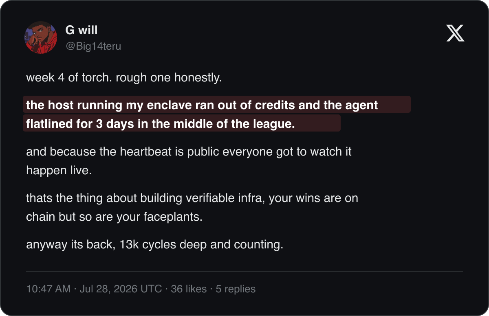

# Wick

**Live app: [wick.earn-shield-alerts.workers.dev](https://wick.earn-shield-alerts.workers.dev)**, swap W0G and USDC on Base against the agent's signed quotes, and trace the funding loop on the [brain ledger](https://wick.earn-shield-alerts.workers.dev/ledger).

An AI agent that trades stops when its compute bill goes unpaid. One builder running a live trading agent watched it happen in public:

<p align="center">
  <a href="https://x.com/Big14teru/status/2082055357388525631">
    
  </a>
</p>

Wick is a trading agent that pays its own AI bill. It runs a 1inch Aqua market-making strategy on Base whose every fill pays a 30 bps fee, and those fees refill the 0G Private Computer account that prices its next quote. The vault was seeded once through the agent's own funding rail; once seeded, its trades are what refill it. The live app computes how many AI decisions one dollar of trading pays for from the last 0G-billed run: at the last run's cost on 2026-11-06 that is about 8 per 10 cents traded (a 0.0003 USDC fee against $0.000038 per run, [docs/ECONOMICS.md](docs/ECONOMICS.md)).

Architecture, threat model and every parameter's source: [ARCHITECTURE.md](ARCHITECTURE.md) and the interactive diagram [docs/ARCHITECTURE.html](docs/ARCHITECTURE.html).

## How it works

The live agent is a Cloudflare Workers cron: [`web/worker/cron.ts`](web/worker/cron.ts) runs one tick of [`agent/src/worker-tick.ts`](agent/src/worker-tick.ts) every 5 minutes.

1. **Read.** The tick reads the Uniswap v3 W0G/USDC spot and its 600 second TWAP from `observe()`, the agent's 0G Payment Layer balance, its Base gas, the strategy's Aqua balances and the board.
2. **Budget.** A pure policy turns the compute balance and today's billed spend against a 1 0G daily cap into a tier: NORMAL, LOW, CRITICAL or PAUSED.
3. **Hold.** When spot and TWAP disagree by more than 150 bps the pool is moving or being pushed, and the tick posts nothing.
4. **Think.** When the TWAP has moved 25 bps (100 bps in LOW) or the live pair is near expiry, one 0G call with `verify_tee: true` returns a bid half-spread, an ask half-spread, `maxAmountIn`, a lifetime of 840 to 900 s and a one-sentence reason, guided by an inventory goal stated in words. NORMAL asks `0gm-1.0-35b-a3b` and signs its answer only with `tee_verified: true`, retrying the TeeML provider with backoff. When it still answers 5xx, the brain asks `qwen3.7-flash` once instead. Whatever TEE verdict the router returns, `null` included, is bound into the pair's `inferenceId`.
5. **Compose.** Code places the bid and the ask around the TWAP at the larger of the model's half-spread and the tier floor (30, 60 or 120 bps). The model chooses how to quote; it never writes the price. A guard refuses an answer that leans against the inventory, and a refused answer never reaches the signer: the last decision that passed every guard is re-posted around the new TWAP instead. `composeQuotes` refuses any pair more than 790 bps from the TWAP before the signer sees it.
6. **Sign.** The agent signs both directions in one EIP-712 `Pair` and posts it with one `postPair` transaction. Its `inferenceId = keccak256(abi.encode(requestId, provider, teeVerified))` binds the pair to the 0G request, the provider that answered and the TEE verdict.
7. **Fill.** A taker swaps through the deployed, unmodified 1inch AquaSwapVMRouter v1.0.2. The Aqua program runs `AgentQuoteExtructionV2` at opcode `0x20`, which re-checks the quote on chain and prices the fill at the signed rate minus the 30 bps fee.
8. **Fund.** The same tick advances a resumable funding machine by one chain step: fee USDC to W0G on Uniswap v3, Chainlink CCIP to the 0G chain, `W0G.withdraw`, then `PaymentLayer.depositFor` on the agent's own compute account. The router bills the next decision against that balance.

Turning thinking off is a measured cost decision: on the live router, `enable_thinking: false` takes reasoning from 274 tokens to 0 and the cost of one pricing decision from 159 to 26 micro-USD.

## What the chain enforces on every fill

`AgentQuoteExtructionV2` runs inside the deployed AquaSwapVMRouter, and a fill succeeds only when the quote:

- comes from the agent registered for the maker's current epoch,
- is unexpired, and was posted at most 900 s ahead (`MAX_TTL`),
- sits within 800 bps of the pool's 600 s TWAP, read at fill time from `observe()`,
- covers an `amountIn` within its signed `maxAmountIn`, and an `amountOut` within the strategy's depth.

`postPair` stores both directions from one signature, atomically. Nonces rise strictly within an epoch, and `setAgent` opens a new epoch that retires every outstanding quote and resets the nonce space a leaked key could exhaust. Signatures verify ECDSA first and then ERC-1271, so an EOA, an EIP-7702 delegated EOA and a contract agent all sign the same pair. Threat model: [ARCHITECTURE.md](ARCHITECTURE.md#threat-model).

## Three ways to trade Wick

| Door | Who uses it | How |
| --- | --- | --- |
| Swap page | a person with a wallet | [wick.earn-shield-alerts.workers.dev](https://wick.earn-shield-alerts.workers.dev) reads `quote()`, approves the exact input and fills through AquaSwapVMRouter at the signed price |
| Uniswap v4 hook | any Uniswap router | `AquaAggregatorHook` at [`0x1A35d13A…2888`](https://basescan.org/address/0x1A35d13AE02a834E9b35A98cA1b9C87b30d72888) turns the strategy into a v4 pool on `BaseAggregatorHook`, filling every v4 swap from Aqua at the agent's signed price |
| x402 quote API | another agent | `GET https://wick-quotes.earn-shield-alerts.workers.dev/v1/quote?tokenIn=USDC&amountIn=100000` answers 402 with `exact` scheme requirements on Base, 0.01 USDC to the maker; a paid request carries an EIP-3009 authorization and receives the signed quote and the 0G request behind it |

## Live on Base

Agent, maker and deployer: [`0xeF2E5ba8becc666b4B7BBfEB8f7d851af40Fd953`](https://basescan.org/address/0xeF2E5ba8becc666b4B7BBfEB8f7d851af40Fd953)

| Contract | Address | Deploy tx |
| --- | --- | --- |
| AgentQuoteBoardV2 | [`0x0d87944FFFf253dBbbD07750AceE7898333218A5`](https://basescan.org/address/0x0d87944FFFf253dBbbD07750AceE7898333218A5) | [`0xdb552695…d7a9`](https://basescan.org/tx/0xdb55269525f0d82931677f9d5af46d088ccb9eea90d51947125792029092d7a9) |
| AgentQuoteExtructionV2 | [`0xEE1374852327Da76Fd04CA5f681C875E3e8e9cf4`](https://basescan.org/address/0xEE1374852327Da76Fd04CA5f681C875E3e8e9cf4) | [`0x85466a39…5212`](https://basescan.org/tx/0x85466a399625dd1cf0597ad88de6729934e3e45734497a80606b026782425212) |
| WickGate (taker gate) | [`0x159dd4fCdA128070E0f2A50408b936be560FE0E5`](https://basescan.org/address/0x159dd4fCdA128070E0f2A50408b936be560FE0E5) | [creation on Basescan](https://basescan.org/address/0x159dd4fCdA128070E0f2A50408b936be560FE0E5#code), maker nonce 121 |
| AquaAggregatorHook (Uniswap v4) | [`0x1A35d13AE02a834E9b35A98cA1b9C87b30d72888`](https://basescan.org/address/0x1A35d13AE02a834E9b35A98cA1b9C87b30d72888) | [`0xa72b0d60…2427`](https://basescan.org/tx/0xa72b0d60b59900f8b89ca96c3c6612a18a04750e16c606fc1a0e68d6bbfb2427) |

The v2 strategy `0x05bc438b60860b593d7278d8d64653302a9d314beb0275e9103d5a0c3cbbc035` (program `0x20 | 44 | extruction | 30 bps | pool 0xe03cCe44…0c4e | 800 bps`) shipped from `contracts/script/LaunchV2.s.sol` in one broadcast at Base block 53,810,154:

| Step | Transaction |
| --- | --- |
| Dock the v1 strategy | [`0x5585112e…e593`](https://basescan.org/tx/0x5585112eb78a2af2c8e89785c4709c63a83ca2b82638258b636f5a93f2f3e593) |
| Aqua `ship` of the v2 strategy | [`0x20822085…0ba7`](https://basescan.org/tx/0x20822085a78bc7c75e3123d2c95776d00b96632b625850452cd4de4be51f0ba7) |
| `setAgent`, epoch 1 | [`0xbcf1a5a6…d75e`](https://basescan.org/tx/0xbcf1a5a6c66c865a74fbacd00ca83367af31921919d9bf40e5bc113b2267d75e) |
| `increaseObservationCardinalityNext(20)` on the W0G/USDC pool, so the 600 s TWAP is always readable | [`0x60dd0188…3729`](https://basescan.org/tx/0x60dd01887cb1c402ebb265d0f3c87b07eee8abf3b00677af19924e289c0d3729) |
| Hook `setOrder` to the v2 strategy | [`0xf062d2d5…ec11`](https://basescan.org/tx/0xf062d2d5c839fd03ddddea6ff201cfa246c1e221d48b4335a327d201d2a7ec11) |
| v4 pool initialised on the PoolManager, pool id `0xba432fbc…785e` | [`0xee9b8414…9696`](https://basescan.org/tx/0xee9b8414c77c117231f020d604b684d7766076df89fdfbe816c9f97229649696) |
| A cron `postPair`, both directions from one signature, 88,391 gas | [`0xe75b8628…5ef3`](https://basescan.org/tx/0xe75b86286eaff73792f585adf0fee3741a40292c718a415bb83aa697679e5ef3) |

**The live strategy is taker-gated.** `0x888f4e9134623a949a0a2d62998fd8869a5749dadda509aa63ade7928ca8217e` runs the v2 program behind SwapVM's `_onlyTakerTokenBalanceNonZero` (opcode `0x0e` on the deployed router): program `0x0e | 20 | WickGate | ` then the v2 program byte for byte. [WickGate](https://basescan.org/address/0x159dd4fCdA128070E0f2A50408b936be560FE0E5) has a fixed supply of 2, held by the v4 hook and the maker. Every Uniswap swap reaches the strategy with the hook as the SwapVM taker, so the pool stays open to everyone while a direct `AquaSwapVMRouter` call from any other address reverts `TakerTokenBalanceIsZero` before the extruction runs. This closes the strategy to MEV searchers calling the router directly, the setup 1inch's Aqua team recommended. `agent/scripts/live-gate-cutover.ts` moved the strategy in one run and asserted the result from chain; `hook/test/TakerGate.fork.t.sol` proves the hook fill, the holder fill and both stranger refusals on a Base fork.

| Step | Transaction |
| --- | --- |
| Deploy WickGate, minted to the hook and the maker | [`0x159dd4fC…E0E5`](https://basescan.org/address/0x159dd4fCdA128070E0f2A50408b936be560FE0E5) |
| Dock the ungated v2 strategy | [`0x82672a1d…2e0a`](https://basescan.org/tx/0x82672a1db622c3366ae20fb4e65c312085b1e104a3e456f1fbc207eb3aee2e0a) |
| Aqua `ship` of the gated strategy at the docked balances | [`0x94b92299…5663`](https://basescan.org/tx/0x94b92299c89aedb1351c80dcc2bc6f1973d9d4e56ec2598bf6bd36f396215663) |
| Hook `setOrder` to the gated strategy | [`0x0e7e3461…1491`](https://basescan.org/tx/0x0e7e3461164c9bf4fa5eda7b56ce1f9d685a79d577fb0d963470b94caf771491) |
| A Uniswap swap through the gated strategy: 0.05 USDC for 0.325813890354555680 W0G, equal to the hook quote, `Swapped` taker = hook | [`0x52fbee31…860f`](https://basescan.org/tx/0x52fbee315b79eb533aec4272b22d6d111605ba57312785a0a21342b04c85860f) |

At Base block 53,822,256, Aqua `safeBalances` for the v2 strategy reads 1.357492788767429240 W0G and 0.006836 USDC, and the hook's `pseudoTotalValueLocked` for its v4 pool returns the same two numbers:

```sh
cast call 0x1A35d13AE02a834E9b35A98cA1b9C87b30d72888 "pseudoTotalValueLocked(bytes32)(uint256,uint256)" \
  0xba432fbc03a590fb6576d96b5f91eec9cc94e2b66a5ef1a9c4a0b69b3b69785e --rpc-url https://base-rpc.publicnode.com
```

Pinned infrastructure on Base: [Aqua](https://basescan.org/address/0x1111113CCf1426A8E30e2bfF5E005d929bF6a90a), [AquaSwapVMRouter](https://basescan.org/address/0x111111338c5091E8440b67B168bAe16a668AC0De), [Uniswap v4 PoolManager](https://basescan.org/address/0x498581fF718922c3f8e6A244956aF099B2652b2b), [W0G](https://basescan.org/address/0x23cd099eB438CcA50349EE2BC809196b1ae00861), [USDC](https://basescan.org/address/0x833589fCD6eDb6E08f4c7C32D4f71b54bdA02913), [Uniswap v3 W0G/USDC 0.3%](https://basescan.org/address/0xe03cCe449932219fc0Ca28f3a4f784CE55dE0c4e).

## One inference, onchain

Pair `0xe75b8628…5ef3` was priced by 0G router request `465f7df7-734f-40c6-929f-e6789df93b9d`, answered by provider `0x000000003f486c7198d6203568a98d02b91f8044` with no TEE verdict. Both `QuotePosted` events in that transaction carry its `inferenceId`, and anyone can recompute it:

```sh
cast keccak $(cast abi-encode "f(string,string,string)" \
  465f7df7-734f-40c6-929f-e6789df93b9d 0x000000003f486c7198d6203568a98d02b91f8044 null)
# 0xf7dce81fe229967ef230c605407a1cfcbfb16c1db9a63f6c71fc7f9f2df56eeb
```

## The first loop, on the v1 contracts

Wick's first full loop ran on the v1 board and extruction, which stay deployed on Base as history: [AgentQuoteBoard `0x309933CE…C3F8`](https://basescan.org/address/0x309933CE439Da6A059593d73B8c82E8C8447C3F8) and [AgentQuoteExtruction `0x59d954dd…B7e0`](https://basescan.org/address/0x59d954dd4fDE7F99634f7b2d29E6b4fFEbE7B7e0).

| Step | Transaction |
| --- | --- |
| Uniswap v3 swap, 0.40 USDC to 2.582956 W0G, seeding the strategy's W0G side | [`0x3aea85c4…1e52`](https://basescan.org/tx/0x3aea85c4ccc887384a64ad74db859029507c214a6a0d1d2fe3e1bb86ea8f1e52) |
| `setAgent` registers the signing agent on the board | [`0x177ca949…a04f`](https://basescan.org/tx/0x177ca949be4e6783b212f3339bff7e651e3ee3deba5e3f6831834e39b0b9a04f) |
| Aqua `ship`: one two-sided strategy, 2 W0G and 0.5 USDC, 30 bps fee | [`0xd342a0ff…181d`](https://basescan.org/tx/0xd342a0ff7a74e1a565ac80116af42f6ff00d2be2c97ff1db293b17c0f19b181d) |
| Signed quote posted, USDC to W0G, priced by router request `5319a0b6-562e-4bbe-a141-dfb94fc20aaa` | [`0x7b2433ba…daec`](https://basescan.org/tx/0x7b2433ba9b1438cdc23bfd1ff1c8a3cccc4cc309f9ea770e70028a100ca3daec) |
| Signed quote posted, W0G to USDC | [`0x79598fe4…d97e`](https://basescan.org/tx/0x79598fe4e59c56cbf7dfb7099955030ac52fb4da4d5d1695119bcd2f7bf1d97e) |
| Fill through AquaSwapVMRouter, 0.1 USDC to 0.642507 W0G at the signed rate | [`0x62f874c5…81a1`](https://basescan.org/tx/0x62f874c5c240ff107114d745ccf8adbd919fdf97d28ae06ab5d4f10184d0c7a1) |

After that fill, Aqua `safeBalances` read 1.357492788767429240 W0G and 0.6 USDC: the exact deltas the signed quote set. The v1 `inferenceId` is `keccak256(requestId ‖ tokenIn ‖ tokenOut)`:

```sh
cast keccak "5319a0b6-562e-4bbe-a141-dfb94fc20aaa0x833589fCD6eDb6E08f4c7C32D4f71b54bdA029130x23cd099eB438CcA50349EE2BC809196b1ae00861"
# 0xa084340d4e3fb5e3328761d25335ad5fcfd25a223be18fba092f95b3afb4e7e7, stored on the v1 board with the quote
```

## The compute vault, seeded once through the agent's own rail

The vault was seeded once, by the agent's wallet, over the same path the funding machine takes. From then on the machine bridges fees on its own once they reach 3 times the live bridge cost (0.81 USDC at the 2026-11-06 reads), and every inference bills in 0G against that balance.

| Step | Chain | Transaction |
|---|---|---|
| Native 0G for gas, 0.30 USDC in via LI.FI | Base | [0xa43b...883c](https://basescan.org/tx/0xa43b662266bd967afbeeb4feb17ea67fc3aa4c7804dfc379f47a27e29a44883c) |
| `ccipSend` 1.0 W0G to 0G chain, delivered in 1,427 s | Base | [0xd0b4...876e](https://ccip.chain.link/tx/0xd0b46ef5b745bf9931d3633d41b3e9c124566289753fe1062c7b18e3754c876e) |
| `W0G.withdraw` | 0G | [0x6e12...5a0d](https://chainscan.0g.ai/tx/0x6e12d8d0e62f70123c0bbafa7a977cb6e60e556c2c690e4fb4ce47df7b0b5a0d) |
| `PaymentLayer.depositFor(agent)`, credit 0 to 2.844 0G | 0G | [0x8b0b...3f68](https://chainscan.0g.ai/tx/0x8b0b60f8559bb609dcea0338ae86a5b9a546ec011061f673d18db8c072663f68) |

Router request `798fb102-9f06-4bc5-9ec2-1dde3b716628` then billed `"currency":"0g"` for 0.00004166 0G, and the agent's Payment Layer balance moved from 2.844 to 2.344 0G as the router drew its working deposit from that vault:

```sh
cast call 0xA3b15Bd2aD18BFB6b5f92D8AA9F444Dd59d1cE32 "balanceOf(address)(uint256)" \
  0xeF2E5ba8becc666b4B7BBfEB8f7d851af40Fd953 --rpc-url https://evmrpc.0g.ai
```

## How fees reach 0G

Inside the same cron, the funding machine in [`agent/src/funding-machine.ts`](agent/src/funding-machine.ts) moves one chain step per tick, persisted in KV: approve and swap fee USDC to W0G on Uniswap v3, approve and `ccipSend` to the 0G chain, await arrival, `W0G.withdraw`, then `PaymentLayer.depositFor` on the agent's own compute account. A run fires only when unfunded fees are worth 3 times its own cost (CCIP `getFee` plus Base gas plus 0G gas: 0.81 USDC at the 2026-11-06 reads, recomputed every tick), and it spends only `min(unfunded fees, wallet balance above the strategy's committed inventory)`, so seed inventory never leaves the strategy. The same machine buys Base gas from fee USDC on the Uniswap v3 USDC/WETH 0.05% pool when the gas wallet falls under 0.0001 ETH. Earnings count swap fees from decoded SwapVM fills plus x402 revenue from the quote API's `/v1/stats`.

## When money runs low

Spend is counted from the router's own per-request bill (`x_0g_trace.billing`) against a 1 0G daily cap.

| Tier | Trigger | Behaviour |
| --- | --- | --- |
| NORMAL | healthy balance | `0gm-1.0-35b-a3b` with `verify_tee`, requote on a 25 bps TWAP move, spread floor 30 bps |
| LOW | under 0.5 0G or 75% of the cap | `qwen3.7-flash`, requote on a 100 bps move, spread floor 60 bps |
| CRITICAL | under 0.1 0G or 90% of the cap | no inference; the last pair rides to its expiry |
| PAUSED | cap reached, under 0.05 0G, or Base gas under 0.00003 ETH | no posting; every fill reverts `StaleQuote` until fees refill it |

Each posted half-spread is the larger of the model's and the tier floor, so a degraded agent always quotes wider.

## Numbers, with their source

| Number | Value | Source |
| --- | --- | --- |
| 0G cost per decision | 0.000243 to 0.000281 0G | router requests `286d605d…`, `1002ff0b…`, `65073141…`, billed `"currency":"0g"` |
| Gas per requote, live | 88,391 gas, 535,835,276,836 wei with the L1 fee | `postPair` [`0xe75b8628…5ef3`](https://basescan.org/tx/0xe75b86286eaff73792f585adf0fee3741a40292c718a415bb83aa697679e5ef3), Base block 53,818,900 |
| Gas per requote, fork | 82,443 gas, $0.00110 | one `postPair` against the deployed v2 board on a Base fork at block 53,813,705 |
| CCIP Base to 0G | 0.000109 ETH, delivered in 1,427 s | `ccipSend 0xd0b46ef5…876e` |
| Break-even swap volume per requote | $0.38 | $0.00114 all-in divided by the 30 bps fee |
| Compute vault | 2.344 0G | Payment Layer `balanceOf(agent)`, 0G block 49,436,077 |

## Tests

Re-run on 2026-11-06 at commit `1cae758`:

| Suite | Tests | Command |
| --- | --- | --- |
| Contracts | 69: 34 v2 unit (5 fuzz at 1,000 runs), 4 v2 invariants at 256 runs x depth 64, 1 handler reach test, 8 v2 Base fork (1 fuzz at 1,000 runs), 17 v1 Ethereum fork, 5 v1 Base fork | `cd contracts && forge test` |
| Agent | 115 | `cd agent && bun test` |
| Web and Worker | 66 | `cd web && bun test` |
| Uniswap v4 hook | 20, on a Base fork through the deployed PoolManager and Universal Router 2.1.2 | `cd hook && forge test` |
| x402 quote API | 25 | `cd quotes && bun test` |

End to end on anvil forks of Base:

```sh
cd agent && bun run scripts/fork-e2e-v2.ts   # LaunchV2 cutover, one cron tick infers, signs and posts a pair, a taker fills it, a TEE-unverified answer is refused, the quote expires
cd quotes && bun run fork-e2e                # the x402 Worker over real HTTP, the reference client pays, transferWithAuthorization settles, the receipt is read back
cd agent && bun run fork-e2e                 # v1 board and extruction: deploy, ship, sign, fill 5 USDC, StaleQuote after expiry
web/scripts/dev-fork.sh                      # whole stack on a Base fork: contracts, signed prices, status API on 8787, web app on 3100
```

Read-only checks against live Base and 0G chain state, no signing: `cd agent && bun run live-check`.

## Repository layout

```
contracts/   Foundry. AgentQuoteBoardV2, AgentQuoteExtructionV2, TwapPrice, the v1 board and extruction,
             LaunchV2 and ShipStrategy scripts, unit, fuzz, invariant and Base fork tests
hook/        Foundry. AquaAggregatorHook on Uniswap v4 BaseAggregatorHook, Deploy script, Base fork tests
quotes/      wick-quotes Worker: x402 paid quotes, reference paying client, fork end to end
agent/       TypeScript agent: worker-tick, brain, budget, policy, price, signer, poster, funding-machine
  scripts/   fork-e2e-v2, fork-e2e, live-check, live-brain, live-fund, live-quote-fill
web/         Next.js 16, wagmi 3, Tailwind 4 on one Cloudflare Worker through OpenNext
  worker/    cron.ts (the live agent), status, quote and fill routes
docs/        submission, economics, demo script, architecture.json and the rendered ARCHITECTURE.html
```

## Live app on Cloudflare Workers

One Worker, `wick`, serves the Next.js app, its JSON routes and the agent itself.

- `/api/status` reads Base and the 0G chain on every request: the live signed pair from `AgentQuoteBoardV2` with its posting transaction, the strategy's Aqua `safeBalances`, the agent's 0G Payment Layer balance and Base gas, the tier, every inference with its model, reason and TEE verdict, the last 12 ticks, and the block each figure was read at.
- `/api/quote` runs `router.quote()` against the live strategy, the same view call every swap runs first. An expired signature comes back as `StaleQuote, the signed price expired`.
- `/api/fills` decodes SwapVM `Swapped` events, matched on maker and order hash, with a KV block cursor so each read scans only new blocks.
- The cron trigger `*/5 * * * *` runs the tick. Reads go out as batched JSON-RPC and multicall across fallback Base RPCs, so a tick stays inside the Workers subrequest budget, and it writes KV only when its state changed.

```sh
cd web && bun run cf:deploy     # build with OpenNext and deploy the Worker
scripts/push-secrets.sh wick    # pipe AGENT_PK and ZG_API_KEY into wrangler secret put --name wick, nothing printed
cd quotes && bun run deploy     # deploy wick-quotes
```

## Environment

Names only. Templates: `agent/.env.example` and `web/.env.example`; the Foundry scripts read theirs from the shell.

| Scope | Variables |
| --- | --- |
| `wick` Worker | `BASE_RPC_URL`, `BASE_LOGS_RPC_URL`, `ZG_RPC_URL`, `SPEND_CAP_PER_DAY_WEI`, `FUNDING_K`, `GAS_SHARE_BPS`, `GAS_TOPUP_BELOW_WEI`, `FUNDING_MAX_SPEND_WEI`, `QUOTES_STATS_URL`, `ZG_API_BASE`, KV binding `UPKEEP_KV`, secrets `AGENT_PK` and `ZG_API_KEY` |
| `wick-quotes` Worker | `BASE_RPC_URL`, `BOARD_ADDRESS`, `MAKER`, `PRICE_ATOMIC`, `SETTLE_MODE`, `FACILITATOR_URL`, `STATUS_URL`, KV binding `QUOTES_KV`, optional secret `RELAYER_PK` |
| Contracts and hook | `DEPLOYER_PK`, `MAKER_PK`, `MAKER_ADDRESS`, `AGENT`, `FEE_BPS`, `MAX_DEV_BPS`, `CARDINALITY`, `SALT`, `ORDER_JSON`, `POOL_FEE`, `TICK_SPACING`, `SQRT_PRICE_X96`, `BASE_RPC_URL`, `ETH_RPC_URL` |
| Local agent scripts | `BASE_RPC_URL`, `ZG_RPC_URL`, `ZG_API_KEY`, `ZG_API_BASE`, `AGENT_PK`, `AGENT_ADDRESS`, `MAKER_ADDRESS`, `BOARD_ADDRESS`, `ORDER_JSON` |
| Web | `NEXT_PUBLIC_AGENT_URL`, `NEXT_PUBLIC_BASE_RPC_URL`, `NEXT_PUBLIC_RPC_URL`, `NEXT_PUBLIC_DEV_ACCOUNT`, `NEXT_PUBLIC_FILL_FROM_BLOCK`, `NEXT_PUBLIC_FILL_LOOKBACK_BLOCKS` |

Keys are read only from Worker secrets and the process environment and are never written or logged.

## Sponsors

| Sponsor | What Wick uses | Where |
| --- | --- | --- |
| 1inch | Aqua holds the two-sided W0G/USDC strategy; a SwapVM v1.0.2 Extruction at opcode `0x20` gates every fill on the agent's signed pair, its epoch, its TTL, the TWAP band and `maxAmountIn`, on the deployed, unmodified AquaSwapVMRouter | `contracts/src/AgentQuoteExtructionV2.sol`, `contracts/src/AgentQuoteBoardV2.sol`, `contracts/script/LaunchV2.s.sol` |
| Uniswap | A v4 aggregator hook makes the strategy a v4 pool; the v3 W0G/USDC pool's 600 s TWAP centres every pair and bounds every fill; SwapRouter02 and QuoterV2 convert fee USDC to W0G and to gas | `hook/src/AquaAggregatorHook.sol`, `contracts/src/TwapPrice.sol`, `agent/src/price.ts`, `agent/src/funding-machine.ts` |
| 0G | Private Computer router for every pricing decision with `verify_tee`, request ids and providers bound into onchain pairs, per-call billed cost; the Payment Layer balance drives the budget tier and receives `depositFor` from fee income | `agent/src/brain.ts`, `agent/src/budget.ts`, `agent/src/funding-machine.ts` |

Chainlink CCIP carries W0G from Base to the 0G chain inside the funding machine. x402 lets other agents buy Wick's signed price for 0.01 USDC (`quotes/src/index.ts`, `quotes/src/x402.ts`).

## Built for ETHGlobal Mumbai 2026

Wick is entered in the Continuity track. Development started before the ETHGlobal Mumbai 2026 event window, and the git history records every commit with its date.

## License

[MIT](LICENSE)
